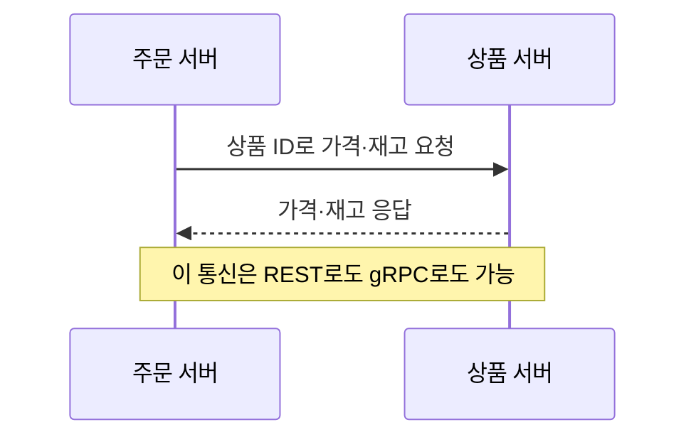
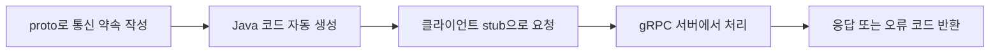

# gRPC, 왜 쓰는가?

## 이 프로젝트에서는 꼭 필요한가?

**아니다. 현재 상품 등록·조회는 REST로 충분하다.**
이번 적용의 목적은 서버 간 gRPC 통신을 배우는 것이다.
“내부 통신이니까 gRPC를 써야 한다”는 설명은 정확하지 않다.

## 그러면 어떤 문제를 해결하는가?

주문 서버가 상품 서버의 가격·재고를 조회한다고 생각해 보자.



**통신이 필요하다는 사실만으로 gRPC를 선택하지 않는다. 아래 요구가 선택 이유다.**

| 실제 요구 | gRPC를 고려하는 이유 | 주의할 점 |
| --- | --- | --- |
| 여러 언어의 서비스가 같은 API를 호출 | `.proto` 하나로 메시지·호출 코드를 생성 | REST도 OpenAPI로 코드 생성 가능 |
| 서비스 사이 데이터 구조를 명시적으로 공유 | 필드 타입과 RPC 입출력을 계약으로 정의 | 필드 변경·버전 관리 규칙은 여전히 필요 |
| 대량 통신에서 전송·처리 비용을 줄여야 함 | protobuf 바이너리와 HTTP/2를 사용 | 실제 성능은 측정해야 함. 항상 REST보다 빠르지는 않음 |
| 연결 하나로 데이터를 계속 주고받아야 함 | 서버·클라이언트·양방향 스트리밍 지원 | 현재 상품 API는 스트리밍을 사용하지 않음 |

## 지금 상품 프로젝트와 비교하면?

| 판단 기준 | 현재 상태 |
| --- | --- |
| 상품 등록·단건·목록 조회 | REST로 구현 가능 |
| 별도 주문 서버의 실제 연동 요구 | 현재 구현에는 없음 |
| REST 통신 성능 문제를 측정했는가? | 없음 |
| 실시간 양방향 스트리밍이 필요한가? | 없음 |
| gRPC 도입 목적 | 학습 및 호출 구조 실습 |

**운영 선택이라면 지금은 REST를 유지하는 것이 합리적이다.**
gRPC는 필요한 요구가 생겼을 때 그 이점과 코드 생성·도구·운영 비용을 비교해 선택한다.

## 이번 실습으로 무엇을 배우는가?



| 단어 | 의미 |
| --- | --- |
| `.proto` | 호출 기능과 입력·출력 데이터의 약속 |
| channel | 접속할 서버 주소·포트를 설정하는 통신 통로 |
| stub | 채널을 통해 요청을 보내는 호출 도우미 |
| 서버 서비스 | 요청을 받아 기존 상품 로직에 연결하는 코드 |

```java
// 접속할 서버 지정. 서버 환경을 검사하는 코드가 아니다.
var channel = NettyChannelBuilder.forAddress("127.0.0.1", 9090)
        .usePlaintext().build();
var stub = ProductServiceGrpc.newBlockingStub(channel);

// 이 줄에서 실제 gRPC 요청을 보낸다.
var response = stub.withDeadlineAfter(5, TimeUnit.SECONDS)
        .getProduct(request);
```

`127.0.0.1`은 호출 프로그램이 실행되는 컴퓨터다.
다른 서버라면 주소를 바꾼다. `usePlaintext()`는 TLS 없이 통신하는 개발용 설정이다.
실제 코드 구조는 [소스 설명](grpc-source-beginner.md)에서 확인한다.
