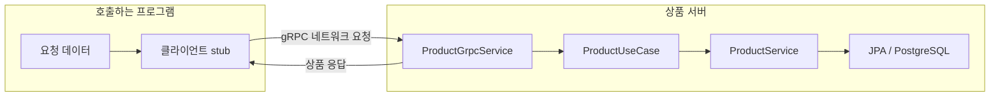
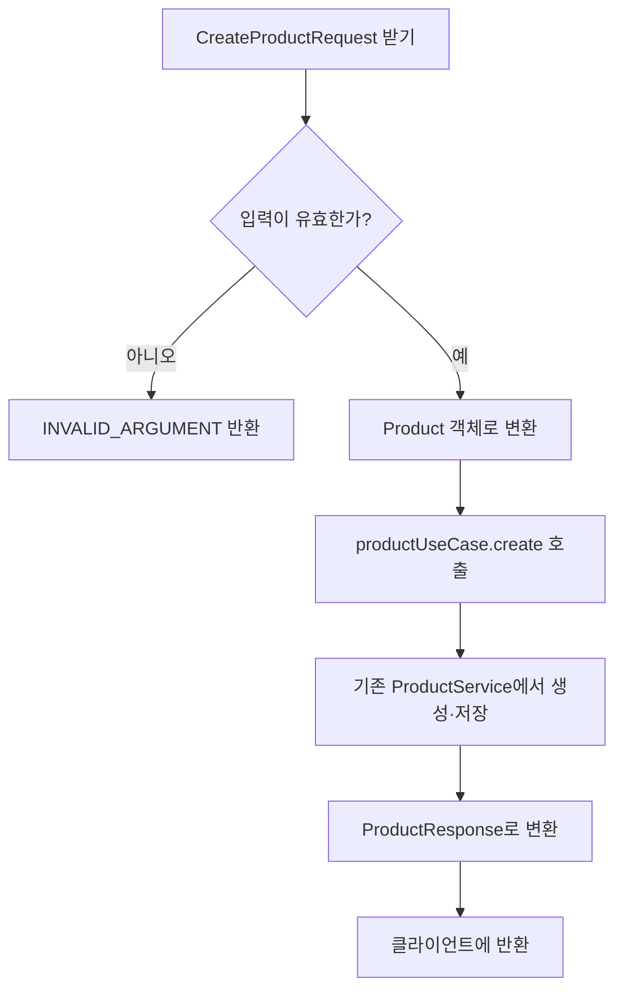

# 상품 gRPC 소스 한눈에 보기

**REST의 상품 로직을 재사용하고, gRPC로 요청을 받는 입구를 추가했다.**
[gRPC를 선택하는 이유와 현재 프로젝트의 한계](grpc-beginner.md)를 먼저 읽으면 좋다.
경로는 프로젝트 루트 `grepp-BE5/backend5` 기준이다.

## 1. 서버와 클라이언트는 어디에 있는가?



클라이언트는 **stub을 호출**한다. `ProductUseCase`는 **상품 서버 내부**에서만 사용한다.

## 2. 읽을 파일은 세 개부터

| 순서 | 파일 | 알아볼 내용 |
| --- | --- | --- |
| ① | [product.proto](../src/main/proto/product.proto) | 무엇을 보내고 받는가? |
| ② | [ProductGrpcService.java](../src/main/java/com/grepp/backend5/product/adapter/in/grpc/ProductGrpcService.java) | 서버가 요청을 어떻게 처리하는가? |
| ③ | [ProductGrpcServiceTest.java](../src/test/java/com/grepp/backend5/product/adapter/in/grpc/ProductGrpcServiceTest.java) | 클라이언트가 어떻게 호출하는가? |

## 3. proto: 입력·출력 약속

```protobuf
rpc CreateProduct(CreateProductRequest) returns (ProductResponse);
rpc GetProduct(GetProductRequest) returns (ProductResponse);
rpc ListProducts(ListProductsRequest) returns (ListProductsResponse);
```

| 기능 | 입력 | 출력 |
| --- | --- | --- |
| 등록 | 판매자·등록자 UUID, 상품명, 가격, 설명·재고·상태 | 저장된 상품 정보 |
| 단건 조회 | 상품 UUID | 상품 정보 |
| 목록 조회 | 없음 | 상품 목록 |

등록 시 설명은 생략 가능, 재고 기본값은 `0`, 상태 기본값은 `ACTIVE`다.
가격은 `"2590000.00"`처럼 문자열로 보내 소수점 정밀도를 유지한다.

`build.gradle`의 protobuf 플러그인이 이 약속을 Java 메시지·서버 기본 클래스·클라이언트 stub으로 변환한다.
**생성된 Java 코드를 수정하지 말고 proto를 수정한다.**

## 4. 서버: 등록 요청을 받으면?



```java
// ProductGrpcService 내부의 핵심 코드
observer.onNext(toResponse(productUseCase.create(input)));
observer.onCompleted();
```

| 코드 | 의미 |
| --- | --- |
| `productUseCase.create(input)` | 기존 상품 생성 기능 호출 |
| `toResponse(...)` | 서버 내부 Product를 통신용 응답으로 변환 |
| `onNext(...)` | 결과 보내기 |
| `onCompleted()` | 정상 종료 |
| `onError(...)` | 오류로 종료 |

검증: UUID 형식, 상품명 최대 100자·공백 금지, 가격 범위·소수 자리수,
재고 음수 금지, 상태 최대 20자·공백 금지.
저장은 `ProductService → ProductPersistenceAdapter → ProductJpaRepository → PostgreSQL` 순서다.

## 5. 테스트: 내부 호출처럼 보이는 이유

**한 테스트 파일에서 서버와 클라이언트를 모두 준비하기 때문이다. 통신은 실제 TCP gRPC다.**


### ① 서버 준비

```java
useCase = mock(ProductUseCase.class); // 상품 로직을 가짜로 대체
server = NettyServerBuilder.forAddress(new InetSocketAddress("127.0.0.1", 0))
        .addService(new ProductGrpcService(useCase)) // 요청 처리 클래스 등록
        .build().start(); // 여기서 서버 시작
```

포트 `0`은 사용 가능한 포트를 자동 선택한다는 뜻이다.
`new ProductGrpcService(...)` 자체는 서버를 시작하지 않는다.

### ② 클라이언트 준비

```java
channel = NettyChannelBuilder.forAddress("127.0.0.1", server.getPort())
        .usePlaintext().build();
client = ProductServiceGrpc.newBlockingStub(channel)
        .withDeadlineAfter(5, TimeUnit.SECONDS);
```

### ③ 실제 호출

```java
var response = client.createProduct(request);
```

`when(...).thenAnswer(...)`는 **서버 뒤의 mock이 반환할 결과**를 설정한다.
gRPC 요청을 생략하거나 DB에 저장하는 코드가 아니다.

| 검증되는 것 | 검증되지 않는 것 |
| --- | --- |
| 실제 네트워크 요청·응답 | 실제 PostgreSQL 저장 |
| 데이터 변환·입력 검증 | Spring Boot 전체 서버 시작 |
| 오류 코드·메시지 | 실제 트랜잭션 동작 |

## 6. 실행해 보기

Java 21 환경에서:

```sh
./gradlew test --tests '*ProductGrpcServiceTest' --rerun-tasks --console=plain
```

등록·조회·기본값·잘못된 입력·처리 실패 등 **10개 테스트**가 있다.
입력, 응답, 오류 코드가 콘솔에 출력된다.

실제 DB 저장은 PostgreSQL 연결 정보를 설정하고 다음 명령으로 앱을 실행한 뒤 호출해야 한다.

```sh
./gradlew bootRun
```

실제 클라이언트에서는 테스트의 `server.getPort()` 대신 기본 포트 `9090`을 사용한다.
호출 프로그램에도 proto에서 생성된 코드와 gRPC 라이브러리가 필요하다.
기본 stub을 재사용한다면 제한 시간은 각 호출 직전에 지정한다.

```java
var request = CreateProductRequest.newBuilder()
        .setSellerId("11111111-1111-1111-1111-111111111111")
        .setCreatorId("22222222-2222-2222-2222-222222222222")
        .setName("맥북 프로")
        .setPrice("2590000.00")
        .setStock(10)
        .build();
var saved = stub.withDeadlineAfter(5, TimeUnit.SECONDS).createProduct(request);
System.out.println(saved.getId());
```

전체 클라이언트 예제와 DB 설정은 [상세 가이드](grpc.md)를 참고한다.

## 7. 오류 코드 읽기

| 코드 | 뜻 |
| --- | --- |
| `INVALID_ARGUMENT` | 입력 확인 필요 |
| `NOT_FOUND` | 상품이 없음 |
| `INTERNAL` | 서버 처리 실패 |
| `UNAVAILABLE` | 서버 주소·포트·실행 여부 확인 |
| `DEADLINE_EXCEEDED` | 응답 제한 시간 초과 |
